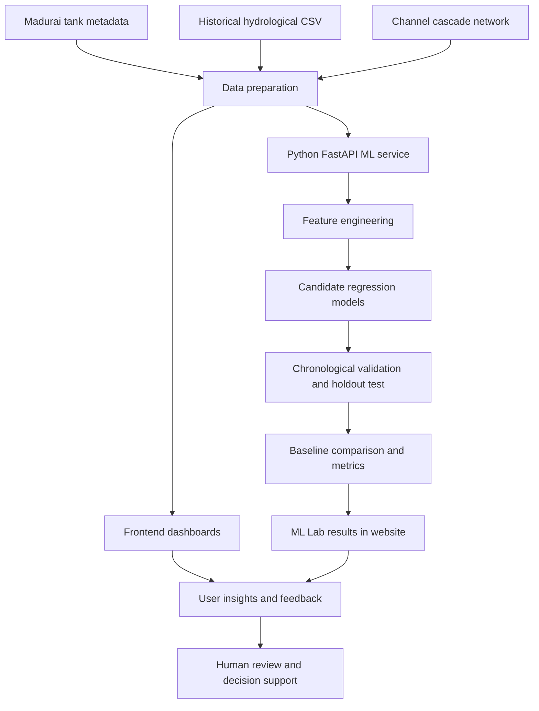

# 💧 Adaptive Water Wisdom Engine (AWWE)
### *Water has a memory. Let's learn from it.*

<p align="center">
  <strong>An experimental, data-driven decision-support platform for more resilient water management in Madurai, Tamil Nadu.</strong>
</p>

<p align="center">
  
  
  
  
</p>

---

## 🌿 Overview

Tamil Nadu can experience two contrasting water challenges: intense rainfall and flooding during wet periods, followed by seasonal water scarcity. Traditional tanks (*eris*) and their interconnected channels are an important part of the region's water-management heritage. Yet understanding their condition, storage, inflows and connections requires reliable information and coordination.

**Adaptive Water Wisdom Engine (AWWE)** explores how historical hydrological data, machine learning and an accessible web interface can bring this information together.

The project is designed as a shared decision-support platform for **households, farmers, tank caretakers and water authorities**. It aims to make tank and water information easier to understand, support more informed planning, and encourage better coordination around capture, storage, conservation and reuse.

> **Our guiding idea:** Capture more rain. Understand water better. Support wiser decisions.

## 🎯 The problem we are exploring

- **Seasonal imbalance:** periods of heavy rainfall and flooding can coexist with dry-season water stress.
- **Disconnected information:** tank storage, rainfall, groundwater and channel condition may be assessed separately.
- **Limited visibility:** communities and decision-makers need understandable, location-relevant information.
- **Coordination gaps:** households, farmers, caretakers and authorities need ways to share observations and respond together.
- **Data quality and trust:** useful decisions depend on verified measurements, clear definitions and transparent uncertainty.

AWWE is intended to support decisions; it does **not** claim to prevent floods or droughts.

## ✨ What the platform brings together

### 🏠 Household workspace
- PIN/postcode-based local tank context.
- Accessible information and practical water-conservation guidance.
- Context for seasonal supply changes, flood readiness and water-quality caveats.
- Community feedback and issue reporting.

### 🌾 Farmer workspace
- Tank storage and historical water context.
- Simple explanations of scarcity-related indicators.
- Practical prompts around irrigation planning, drainage awareness and conservation.
- Feedback channel to support communication with authorities.

### 🏛️ Water-authority workspace
- Tank register and selected-tank operating snapshot.
- Historical rainfall, storage, water-level and hydrological trends.
- Tank-cascade channel connections.
- Infrastructure context and restoration-priority information from the supplied data.
- Community feedback inbox and report-status workflow.

### 📈 Trends & outlook
- Historical rainfall and storage charts.
- Month-range filters and full-year view.
- Tank-specific data exploration.
- Illustrative scenario controls; scenario sliders are conceptual, not operational controls.

### 📨 Feedback & reports
- Household/farmer issue submissions with tank context.
- Authority-side review and report status updates.
- Timestamped reply history.
- CSV export and print/save-as-PDF options.
- In the current browser prototype, reports are stored in that browser's `localStorage`; they are not synchronised across users or devices.

## 🧠 How the technology works

The project separates the user interface from the experimental Python machine-learning service.



### Data layer

The repository includes three principal datasets:

| File | Purpose |
|---|---|
| `madurai_tank_master_metadata.csv` | Tank identifiers and metadata such as location-related details and tank characteristics. |
| `madurai_daily_hydrological_timeseries.csv` | Daily historical rainfall, weather, storage, water-level, inflow, outflow, groundwater and risk-index fields. |
| `madurai_channel_cascade_network.csv` | Relationships and channel/infrastructure information connecting tanks. |

The current daily dataset contains **4,380 records** (12 tanks × 365 days) covering **1 January–31 December 2025**. These records are synthetic/unvalidated project data, not verified operational measurements.

### Machine-learning workflow

The experimental Python service in `ml_service.py`:

1. Loads and checks the hydrological CSV schema.
2. Orders records by tank and date.
3. Builds current-day numeric features, lagged features, rolling means and calendar features.
4. Creates a next-day target from the recorded `scarcity_risk_index`.
5. Compares candidate regressors: Extra Trees, Random Forest and Histogram Gradient Boosting.
6. Uses a chronological **70% train / 15% validation / 15% test** split.
7. Selects the candidate model and baseline using validation data.
8. Reports held-out MAE, RMSE and R², baseline comparisons, per-tank metrics and sample predictions.
9. Performs feature-group ablation on validation data only; this indicates predictive signal, not causation.

### Baselines matter

AWWE compares machine-learning predictions with simple alternatives:
- Persistence (use today's recorded index as tomorrow's estimate).
- Three-day rolling average.
- Seven-day rolling average.

A complex model is useful only if it demonstrates an improvement over simple methods on data it did not use for tuning. The ML Lab is designed to make that comparison visible rather than presenting AI predictions without verification.

## 🧰 Technology stack

| Layer | Technologies |
|---|---|
| Frontend | HTML5, CSS3, JavaScript |
| Charts | Chart.js |
| Backend API | Python, FastAPI, Uvicorn |
| Data processing | Pandas, NumPy |
| Machine learning | scikit-learn |
| Data storage (prototype) | CSV files and browser `localStorage` |
| Repository / hosting | GitHub; static hosting can use GitHub Pages or another static host |

No frontend build framework is required for the current static website.

## 🚀 Run the website locally

### Option A — Static website

1. Clone the repository:

   ```bash
   git clone https://github.com/kamal2716/Adaptive-Water-Wisdom-Engine-AWWE-.git
   cd Adaptive-Water-Wisdom-Engine-AWWE-
   ```

2. Start a local static server from the repository root. For example, with Python:

   ```bash
   python -m http.server 5500
   ```

3. Open:

   ```text
   http://localhost:5500
   ```

The static site loads its CSV assets from the site. Avoid opening `index.html` directly with a `file://` URL because browser security rules can block data requests.

### Option B — Experimental Python ML service

The website and Python API run separately. The API is required for the ML Lab; the static website alone does not run Python.

**Requirements:** Python 3.11 or 3.12 is recommended.

1. Create and activate a virtual environment:

   **Windows PowerShell**
   ```powershell
   python -m venv .venv
   .venv\Scripts\Activate.ps1
   ```

   **macOS / Linux**
   ```bash
   python3 -m venv .venv
   source .venv/bin/activate
   ```

2. Install dependencies:

   ```bash
   pip install -r requirements-ml.txt
   ```

3. Ensure these files are available together:
   - `ml_service.py`
   - `requirements-ml.txt`
   - `madurai_daily_hydrological_timeseries.csv`

   If the CSV is stored elsewhere, set `AWWE_DATA_CSV` to its full path before starting the service.

4. Start FastAPI:

   ```bash
   uvicorn ml_service:app --reload --port 8000
   ```

5. Check the service:

   | Endpoint | Purpose |
   |---|---|
   | `http://127.0.0.1:8000/` | Service information |
   | `http://127.0.0.1:8000/api/ml/status` | Evaluation status and metrics |
   | `http://127.0.0.1:8000/docs` | Interactive API documentation |
   | `http://127.0.0.1:8000/api/ml/predict` | Experimental latest-row extrapolation |
   | `http://127.0.0.1:8000/api/ml/predict?tank_id=TN_MDU_E001` | Experimental prediction for one tank |

6. Open the website, scroll to **ML checkpoints & verification**, keep the API URL as `http://127.0.0.1:8000` for local testing, then select **Connect / refresh** or **Run evaluation**.

Keep the API terminal running while using the ML Lab. The prediction endpoint uses the last available historical row; with data ending in 2025, it is **not a current-day forecast**.

### Public deployment note

A static host such as GitHub Pages or Vercel can serve the frontend, but it does not automatically host this Python API. Deploy the API separately to a Python-capable host, configure the frontend to use its HTTPS URL, and restrict API CORS to the intended website origin before production use.

## 🗂️ Important project files

| File | Description |
|---|---|
| `index.html` | Main application structure and page sections. |
| `styles.css` | Visual design, layout and responsive styling. |
| `app.js` | Dashboard interactions, CSV loading, charts, feedback and ML Lab connection. |
| `ml_service.py` | Experimental FastAPI service and ML evaluation workflow. |
| `requirements-ml.txt` | Python dependencies for the ML service. |
| `ML_README.md` | Additional ML setup, evaluation and limitation notes. |
| `madurai_tank_master_metadata.csv` | Tank master data. |
| `madurai_daily_hydrological_timeseries.csv` | Daily historical hydrological dataset. |
| `madurai_channel_cascade_network.csv` | Tank-channel network dataset. |

## 🔬 Pilot approach

The proposed next step is a **focused real-world pilot in Madurai**, beginning with a small number of selected tanks rather than immediate city-wide deployment.

A responsible pilot could:
1. Select participating tanks and confirm their identifiers, boundaries and channel links.
2. Collect actual field observations and verify units, timestamps and data quality.
3. Compare recorded conditions with AWWE's historical views and experimental predictions.
4. Evaluate model performance against simple baselines using real observations.
5. Gather feedback from farmers, caretakers and water authorities.
6. Refine the platform and decide whether wider testing is justified.

The number of tanks, participants, schedule and operating arrangements should be agreed with local stakeholders. This is a proposed validation pathway, not a completed field deployment.

## ⚠️ Data, safety & current limitations

Transparency is part of the project.

- **Synthetic/unvalidated dataset:** the current hydrological timeseries is project data for experimentation, ending 31 December 2025. It is not live telemetry or verified field history.
- **Experimental scarcity target:** model scores measure agreement with the dataset's recorded scarcity index, not independently measured real-world water scarcity.
- **No official warning service:** risk-index definitions, units, thresholds and validation need confirmation before warning use.
- **No live sensors established:** the current repository does not demonstrate continuous sensor ingestion from Madurai tanks.
- **No verified water-quality labels:** storage volume does not establish that water is safe to drink. Water-quality claims require appropriate tests and verified results.
- **No shared reporting database:** feedback and replies are stored in the current browser's local storage. They are not a central multi-user record.
- **No automatic infrastructure control:** AWWE does not operate sluice gates, release water or allocate supplies. Authorized officials must review and approve operational decisions.
- **No guaranteed flood/drought prevention:** the platform explores ways to improve information and preparedness; actual outcomes require field validation and appropriate infrastructure and governance.

See [ML_README.md](ML_README.md) for additional information about the model, endpoints and evaluation.

## 🌱 Longer-term direction

Potential future development areas include:
- Verified tank-level and rainfall sensor integration.
- Authenticated backend and shared database for community reports.
- Tamil-language support and accessible farmer-facing explanations.
- Time-stamped water-quality test results from qualified sources.
- Better data-quality checks, provenance and missing-data handling.
- Model retraining and evaluation on real observations with seasonal holdouts.
- Role-based access, audit history and official advisory approval workflows.
- Pilot measurement of practical outcomes such as data completeness, response time and usefulness to local users.

These are future directions, not claims about features already deployed.

## 🤝 Contributing

Ideas, issue reports and technical feedback are welcome. Before proposing model improvements, please document the data source, target definition, time split, baseline results and limitations. Do not include private personal data, credentials, API keys or sensitive infrastructure information in commits or issues.

## 📜 License

No license has been specified in this repository yet. Unless a license is added, the project should not be assumed to grant permission for reuse, modification or redistribution.

---

<p align="center">
  <strong>Adaptive Water Wisdom Engine</strong><br/>
  <em>Connecting tank knowledge, data and community decisions for a more water-resilient future.</em>
</p>
